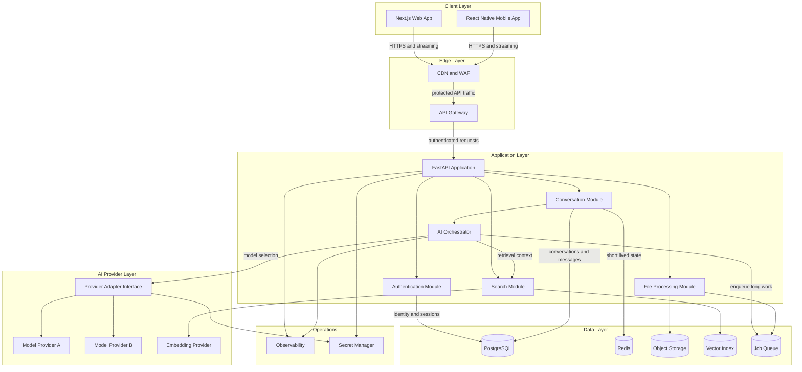
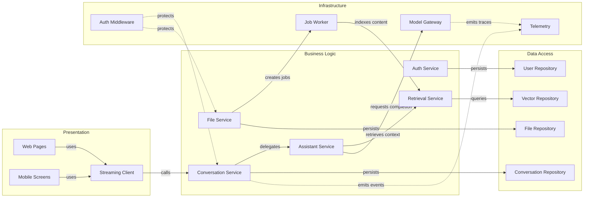

# Architecture Diagram

This document describes the proposed architecture for a provider-independent AI assistant. The initial release uses a modular monolith with asynchronous workers so the product can ship quickly while preserving clear scaling boundaries.

## Application Architecture

<!-- mermaid-checked: no \n, no em-dash/en-dash, no {} in labels, subgraphs are id["label"], arrows are -->|"label"|, all subgraphs closed by end, ids unique -->

### Technology Stack Summary

| Layer | Technology | Version | Purpose |
|---|---|---:|---|
| Web | Next.js, React, TypeScript | Current LTS at implementation | SSR, accessible UI, streaming chat |
| Mobile | React Native with Expo | Current stable | iOS and Android client using shared contracts |
| API | Python, FastAPI, Pydantic | Python 3.12+ | Typed HTTP and streaming API |
| Async work | Celery or Dramatiq, Redis | Current stable | File parsing, embedding, retries |
| Primary data | PostgreSQL | 16+ | Users, tenants, conversations, audit records |
| Cache and limits | Redis | 7+ | Rate limits, ephemeral state, response caching |
| Files | S3-compatible object storage | Managed service | Source files, exports, attachments |
| Search | PostgreSQL full-text plus pgvector initially | Current stable | Keyword and semantic retrieval |
| AI abstraction | Internal provider adapters | N/A | Switch models without changing product code |
| Authentication | OIDC-compatible identity provider | Managed | Login, MFA, social and enterprise identity |
| Deployment | Containers on managed Kubernetes or container apps | Managed | Independent scaling for API and workers |
| Observability | OpenTelemetry, managed logs and metrics | Current stable | Latency, cost, reliability, trace correlation |

### Data Storage & External Services

PostgreSQL is the system of record and stores tenant-scoped product data. Redis handles rate limiting, distributed locks, short-lived stream state, and selected caches; it is never the source of truth. Object storage holds user files and generated exports with encrypted, time-limited access. PostgreSQL full-text search and pgvector are the default search path to reduce operational complexity; a dedicated search service can be added when corpus size or query latency justifies it. Model providers are accessed only through the adapter interface, and credentials are held in a managed secret store.

### Key Architectural Decisions

- Start as a modular monolith with separate API and worker processes; extract services only when measured load, ownership, or deployment frequency requires it.
- Use a provider-independent model gateway with capability discovery, timeout budgets, retries, fallback policy, and per-tenant cost accounting.
- Treat every model response as untrusted external data: enforce structured output validation, tenant authorization, prompt-injection defenses, and auditability.

## Component Relationships

<!-- mermaid-checked: no \n, no em-dash/en-dash, no {} in labels, subgraphs are id["label"], arrows are -->|"label"|, all subgraphs closed by end, ids unique -->

### Component Inventory

| Component | Layer | Type | Responsibility |
|---|---|---|---|
| Web Pages | Presentation | Next.js routes | Render authenticated assistant workflows |
| Mobile Screens | Presentation | React Native screens | Provide mobile parity for core workflows |
| Streaming Client | Presentation | Shared client library | Consume token and event streams with reconnect |
| Auth Service | Business Logic | Application service | User, tenant, session, and authorization rules |
| Conversation Service | Business Logic | Application service | Conversation lifecycle, messages, titles, and history |
| Assistant Service | Business Logic | Application service | Prompt assembly, tool policy, model execution |
| File Service | Business Logic | Application service | Upload authorization, metadata, and processing state |
| Retrieval Service | Business Logic | Application service | Hybrid search, filters, citations, and context limits |
| User Repository | Data Access | Repository | User and tenant persistence |
| Conversation Repository | Data Access | Repository | Conversation and message persistence |
| File Repository | Data Access | Repository | File metadata and processing state |
| Vector Repository | Data Access | Repository | Chunk, embedding, and retrieval persistence |
| Auth Middleware | Infrastructure | Middleware | Token verification and tenant context |
| Model Gateway | Infrastructure | Adapter boundary | Normalized calls to chat, tool, and embedding providers |
| Job Worker | Infrastructure | Worker process | Durable asynchronous processing and retries |
| Telemetry | Infrastructure | Cross-cutting service | Traces, metrics, structured logs, and cost events |
